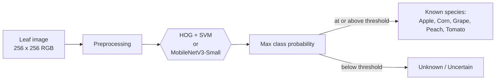
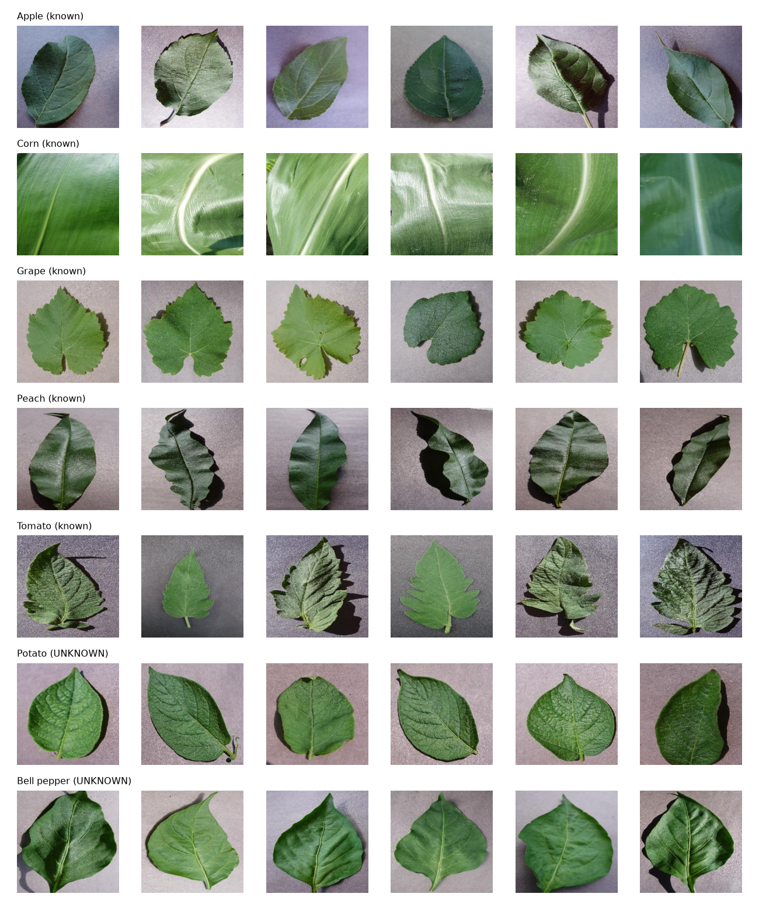
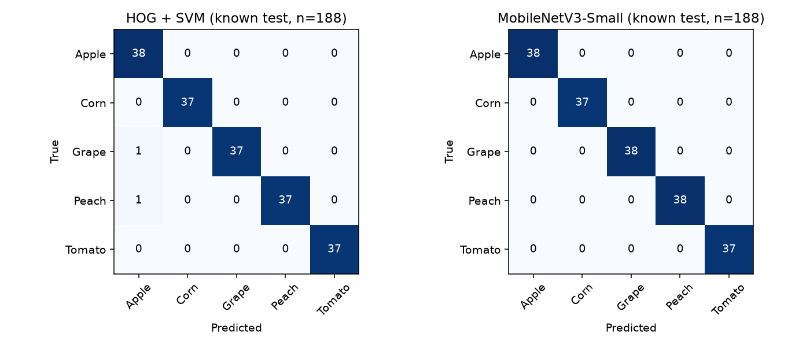
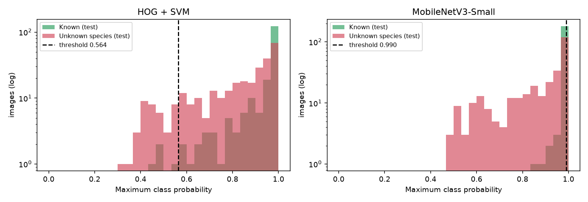
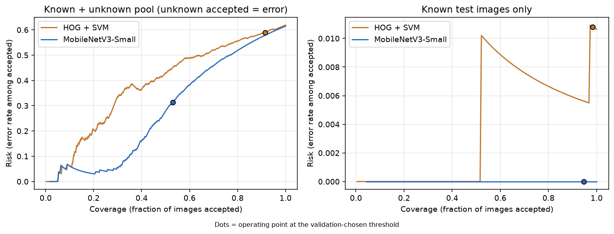
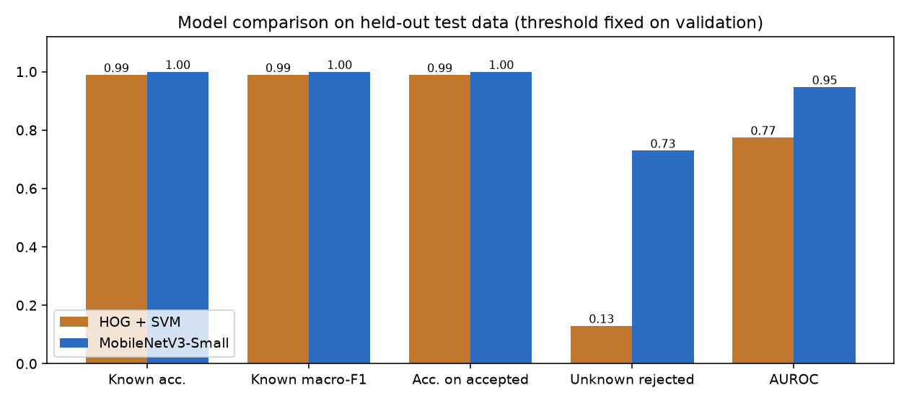

# Can Your AI Admit It Doesn't Know?

**Open-set leaf classification with confidence-based rejection on PlantVillage**


A classifier trained on five plant species must answer with one of those five, even when shown a sixth. This project asks
whether a simple safeguard helps: **abstain ("Unknown / Uncertain") when the model's maximum class probability is low.**
Two models (a classical HOG + SVM baseline and a pretrained MobileNetV3-Small) are trained on five species and then shown two
species they have never seen.

**Central finding (single seed, primary split).** Both models classify the five known species almost perfectly
(98.9% and 100% accuracy), yet at a threshold that keeps 95% of known validation images, MobileNetV3-Small rejects 73.0% of
unknown-species leaves and HOG + SVM only 13.0%. High closed-set accuracy says little about knowing what you do not know,
and even the better model still accepts about a quarter of the unknown leaves.

> **Read before quoting numbers.** The primary split is image-level and shares physical leaves between train and test
> (measured with the dataset authors' leaf maps). Leaf maps are missing for Corn, Grape and part of Tomato, so no fully
> leaf-independent split is possible. Two sensitivity experiments are reported next to the primary results. See [Limitations](#limitations).

## Pipeline



## Data and protocol

| | Species | Images | Role |
|---|---|---|---|
| Known | Apple, Corn, Grape, Peach, Tomato | 250 each (70/15/15 split: 875 train, 187 val, 188 test) | trained and evaluated |
| Unknown | Potato, Bell pepper | 150 each (300 total) | **evaluation only, never used in training** |

- Healthy leaves only (the target is species, not disease). Source: PlantVillage `raw/color`, 1,550 images, all 256 × 256.
- Unknown species are **not** output classes; each model has exactly five outputs. "Unknown" is a decision made by the threshold.
- Threshold = 5th percentile of max-softmax confidence on **known validation images only**, frozen before any test metric is computed.
  It fixes validation acceptance at about 95% by construction; it is not tuned to reject unknowns.
- Exact SHA-256 duplicates were removed before sampling. Seed 42, one run per configuration.


*Six images per species. Corn images are close-ups, a very different look from the other species.*

## Primary results

Primary protocol (image-level stratified split), known test n = 188, unknown test n = 300.

| | HOG + SVM | MobileNetV3-Small |
|---|---|---|
| Rejection threshold | 0.564 | 0.990 |
| Known test accuracy / macro-F1 | 0.989 / 0.990 | 1.000 / 1.000 |
| Known false rejection | 1.6% | 5.3% |
| **Unknown species rejected** (Potato / Bell pepper) | **13.0%** (10.7 / 15.3) | **73.0%** (60.7 / 85.3) |
| AUROC, known vs unknown (95% bootstrap CI) | 0.775 (0.730–0.818) | 0.948 (0.928–0.966) |
| Pool coverage / pool risk | 0.914 / 0.590 | 0.531 / 0.313 |

MobileNet's 100% accuracy has an exact 95% interval of 0.981–1.000 (188/188 correct); the percentile bootstrap collapses to [1, 1] there.
Pool risk counts an accepted unknown as an error and depends on the 61.5% unknown share of the pool.

## Sensitivity to the split protocol

The same code and thresholding rule were re-run on two alternative splits. **Every row is a different split with different
training, validation and test images and a different threshold**, so rows are not paired comparisons.

| Model | Split protocol | Known test n | Accuracy | Known false rejection | Unknown rejected | AUROC |
|---|---|---|---|---|---|---|
| MobileNetV3-Small | Primary (image-level) | 188 | 1.000 | 5.3% | 73.0% | 0.948 |
| MobileNetV3-Small | Frame-block heuristic + guard band | 188 | 1.000 | 5.3% | 66.0% | 0.919 |
| MobileNetV3-Small | Hybrid leaf-aware | 186 | 0.995 | 11.3% | 73.3% | 0.898 |
| HOG + SVM | Primary (image-level) | 188 | 0.989 | 1.6% | 13.0% | 0.775 |
| HOG + SVM | Frame-block heuristic + guard band | 188 | 0.957 | 6.4% | 19.3% | 0.748 |
| HOG + SVM | Hybrid leaf-aware | 186 | 0.957 | 2.2% | 12.3% | 0.799 |

- **Frame-block:** keeps runs of 50 consecutive frame numbers together and drops images within 5 frames of another split. Heuristic, based on file numbers only.
- **Hybrid leaf-aware:** whole physical leaves are assigned to one split using the authors' leaf maps (Apple, Peach, Tomato-RS); the other 600 of 1,250 known images fall back to the frame-block heuristic. **It is not fully specimen-independent.**
- The metrics move in mixed directions (MobileNet AUROC falls, HOG + SVM AUROC rises slightly). Because images, thresholds and models all differ, **a lower score does not by itself prove that leakage inflated the primary results**; the leaf sharing is measured, its effect on the scores is a hypothesis. The qualitative conclusion (MobileNet separates unknowns better than HOG + SVM, yet still accepts many) holds in all three protocols.

## Visual results


*Known-class confusion matrices (primary split). Almost everything is on the diagonal.*


*Max-class-probability histograms (log scale, primary split). MobileNet's known images pile up near 1.0, but so do many unknown ones; the dashed line is the validation-chosen threshold.*


*Risk–coverage (primary split). Left: pool with unknown leaves, where accepting an unknown counts as an error. Right: known images only. Dots mark the operating point.*


*Model comparison (primary split).*

Further figures: [failure gallery, MobileNet](artifacts/figures/failure_gallery_mobilenet.png) ·
[failure gallery, HOG + SVM](artifacts/figures/failure_gallery_hog_svm.png) ·
[synthetic stress test](artifacts/figures/stress_test.png) ·
[frame-neighbour montage](artifacts/figures/frame_neighbours.png). Figures for the sensitivity splits are in `artifacts/variant_*/figures/`.

## Interpretation

- **Accuracy is not unknown recognition.** Both models are near-perfect on the five known species, yet the closed-set task never tests what happens on a sixth species.
- **AUROC and rejection rate answer different questions.** AUROC (0.948 for MobileNet) measures how well confidence *ranks* known above unknown over all thresholds. The rejection rate (73.0%) is one operating point, fixed by keeping 95% of known validation images. A high AUROC can coexist with a large fraction of unknowns accepted.
- **Failure mode (primary split, MobileNet):** 59 Potato images are accepted, and 52 of them are labelled Tomato. Potato and Tomato are both Solanaceae; this is an observation of the saved predictions, not an explanation of what the network sees.
- **Potato is harder than Bell pepper** in every protocol (e.g. 60.7% vs 85.3% rejected in the primary split).

## Limitations

1. **Incomplete leaf-group mapping.** The authors' leaf maps at the pinned commit cover Apple (250/250) and Peach (250/250) fully, Tomato partly (150/250; the 100 `GH_HL` files are not in any sheet), and **Corn and Grape not at all**. Potato and Bell pepper are fully mapped (38 and 93 leaves).
2. **Confirmed leaf overlap in the primary split.** All 38 Peach test images, 24 of 38 Apple and 9 of 25 mapped Tomato test images share a physical leaf with a training or validation image. Corn and Grape cannot be checked.
3. **The hybrid split is not fully specimen-independent** (48% of known images use the heuristic), and the frame-block ordering is verified as acquisition order only where leaf maps exist.
4. **Controlled imagery.** PlantVillage photographs are single leaves on plain backgrounds. Results do not establish field performance.
5. **Only two unknown species**, both Solanaceae like Tomato, and the 300 unknown images are only 131 physical leaves.
6. **Uncalibrated confidence.** Max-softmax is a heuristic score; MobileNet probabilities saturate near 1.0.
7. **One seed; limited uncertainty estimates.** Bootstrap intervals resample images (a leaf-clustered version is also reported) and hold models, thresholds and splits fixed.
8. **Exploratory domain-shift observation, not a benchmark.** In informal manual use of the demo, some real internet photographs of Apple and Corn were reported to be rejected at the current threshold. No such images are stored or evaluated in this repository, so this is anecdotal and should be read as a hint of domain shift, not a measurement.

Full list: [reports/limitations.md](reports/limitations.md).

## Quick start

Python 3.11 is assumed; versions are pinned in [requirements.txt](requirements.txt) (full freeze in `environment.txt`). Tested on macOS arm64 (Apple M4, PyTorch MPS); CUDA and CPU are auto-detected but untested.

```bash
uv venv --python 3.11 .venv                                      # or any Python 3.11 venv
uv pip install --python .venv/bin/python -r requirements.txt
PY=.venv/bin/python
```

**Raw images and trained weights are not in Git** (`data/raw/` and `*.pth` / checkpoints are ignored). Everything below that needs them says so.

**1. Get and verify the data** (needed for training/evaluation). Download the seven `raw/color` folders listed below from
[spMohanty/PlantVillage-Dataset](https://github.com/spMohanty/PlantVillage-Dataset) at commit `7f7ecc7e1eaca78107e3affe7cb5abd9427e139a`
into `data/raw/`, then check them against the committed manifest:

```bash
git clone --depth 1 --filter=blob:none --sparse https://github.com/spMohanty/PlantVillage-Dataset.git /tmp/pv
cd /tmp/pv && git sparse-checkout set --no-cone "raw/color/Apple___healthy" "raw/color/Corn_(maize)___healthy" \
  "raw/color/Grape___healthy" "raw/color/Peach___healthy" "raw/color/Tomato___healthy" \
  "raw/color/Potato___healthy" "raw/color/Pepper,_bell___healthy" && git checkout
mkdir -p <this repo>/data/raw && cp -R /tmp/pv/raw/color/* <this repo>/data/raw/
$PY -m src.verify_data          # expects: 1550/1550 files match the manifest
```
This clones current `master`; to pin the audited commit, run `git fetch --depth 1 origin 7f7ecc7e1eaca78107e3affe7cb5abd9427e139a && git checkout FETCH_HEAD` before copying (the fetch-by-SHA step was not tested). `verify_data` is the actual check.

**2. Full reproduction** (about 1–2 minutes on an M4; downloads ImageNet weights on first run):

```bash
$PY -m src.data && $PY -m src.eda
$PY -m src.train_baseline && $PY -m src.train_mobilenet
$PY -m src.evaluate                       # threshold from validation, metrics, figures
$PY -m src.stress_test && $PY -m src.bootstrap_ci     # optional
```

**3. Sensitivity experiments** (write to `artifacts/variant_*/`, primary outputs untouched):

```bash
$PY -m src.grouped_split && $PY -m src.leafmap_split          # build the two alternative manifests
for v in blockwise leafmap; do
  LEAF_VARIANT=$v $PY -m src.train_baseline && LEAF_VARIANT=$v $PY -m src.train_mobilenet \
  && LEAF_VARIANT=$v $PY -m src.evaluate && LEAF_VARIANT=$v $PY -m src.bootstrap_ci
done
$PY -m src.leafmap_audit && $PY -m src.leakage_audit
```

**4. Inference and demo** (need trained checkpoints, so run step 2 first):

```bash
$PY -m src.predict path/to/leaf.jpg [--model mobilenet|hog_svm]
.venv/bin/streamlit run app.py
```
Both use the same preprocessing and the frozen threshold in `artifacts/metrics/open_set_results.json`. "Unknown / Uncertain" means *low confidence*, not a botanical identification.

**5. Tests and notebook:**

```bash
$PY -m pytest -q                                          # 30 tests
uv pip install --python $PY -r requirements-notebook.txt   # notebook-only dependencies
.venv/bin/jupyter nbconvert --to notebook --execute --inplace notebooks/leaf_open_set_analysis.ipynb
```
The notebook loads saved outputs (no retraining) and asserts that recomputed metrics match the saved ones.

## Project structure

```
app.py                      Streamlit demo
configs/experiment.json     seed, split ratios and training settings
src/                        data, preprocessing, models, open-set metrics, evaluation, audits, inference
tests/                      pytest suite (30 tests)
notebooks/                  leaf_open_set_analysis.ipynb
data/metadata*.csv          primary, frame-block and hybrid split manifests
data/leaf_maps/             authors' leaf sheets (unmodified) + PROVENANCE.json (commit, SHA-256)
artifacts/{metrics,figures,logs,predictions}/   primary results
artifacts/variant_{blockwise,leafmap}/          sensitivity results
reports/                    experiment_report, limitations, final_audit, presentation_outline
```

## Reports

| Document | Contents |
|---|---|
| [reports/experiment_report.md](reports/experiment_report.md) | full methodology and results |
| [reports/limitations.md](reports/limitations.md) | assumptions and what was not tested |
| [reports/final_audit.md](reports/final_audit.md) | leakage investigation, metric audit, leaf-map coverage |
| [reports/presentation_outline.md](reports/presentation_outline.md) | slides, speaker notes, viva Q&A |
| [notebooks/leaf_open_set_analysis.ipynb](notebooks/leaf_open_set_analysis.ipynb) | reproducible analysis |
| [PROJECT_PLAN.md](PROJECT_PLAN.md) | original plan |

## Data provenance and acknowledgements

Images come from the PlantVillage dataset, via the mirror [spMohanty/PlantVillage-Dataset](https://github.com/spMohanty/PlantVillage-Dataset)
at commit `7f7ecc7e1eaca78107e3affe7cb5abd9427e139a`; all 1,550 used images were verified byte-identical (SHA-256) to that commit.
The loader at that commit declares CC BY-SA 3.0 for the data. Leaf maps in `data/leaf_maps/` are unmodified upstream files.

> Hughes, D. P. and Salathé, M. (2015). *An open access repository of images on plant health to enable the development of mobile disease diagnostics.* arXiv:1511.08060.

Backbone weights are torchvision's ImageNet-pretrained MobileNetV3-Small. **This repository has no project license yet;** add one before
others reuse the code. Raw images and checkpoints are not redistributed here.
